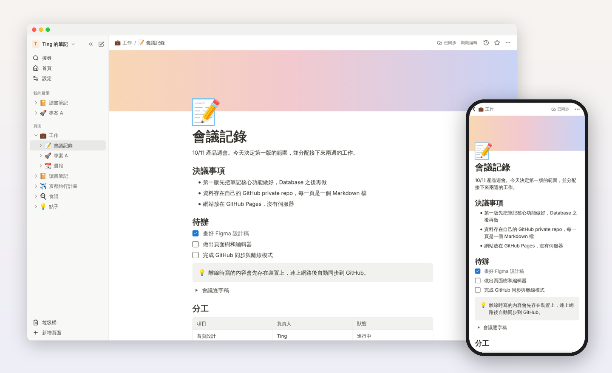
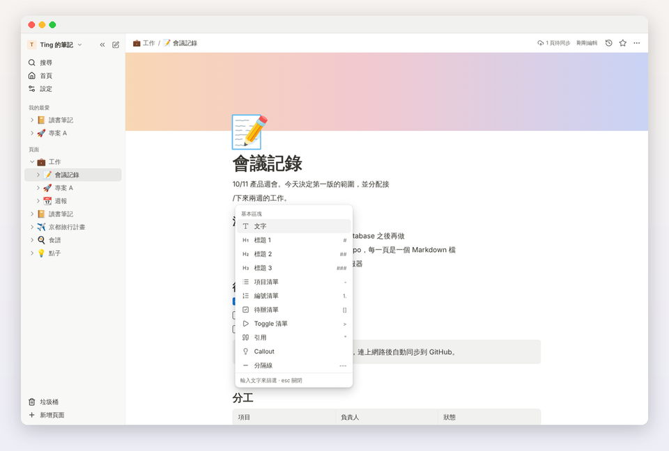
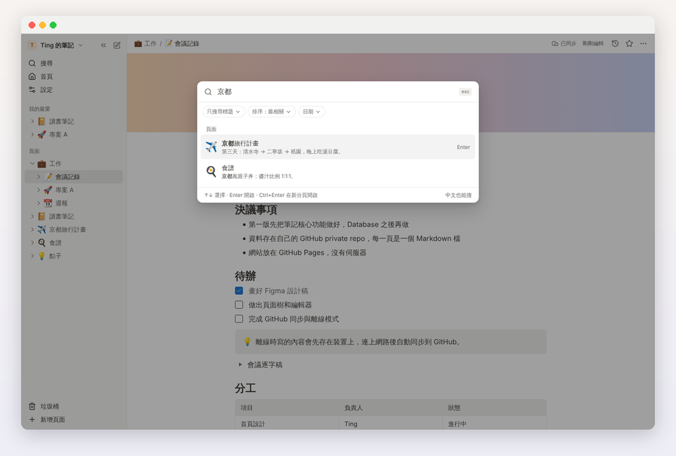
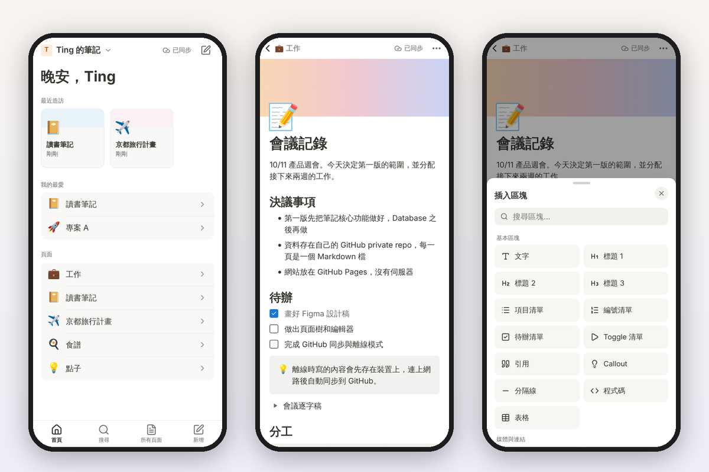
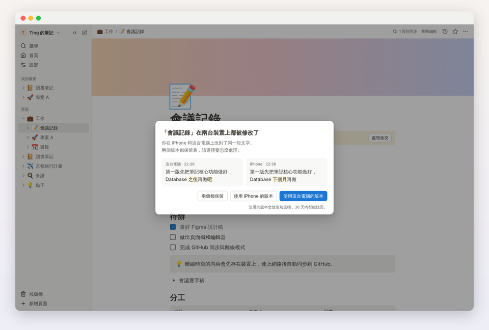
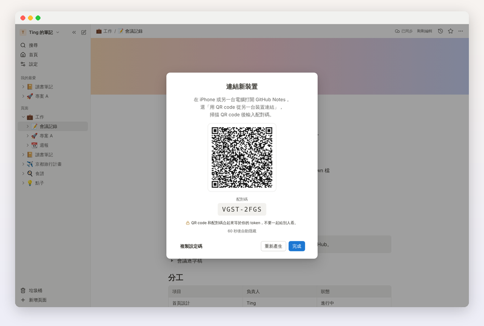
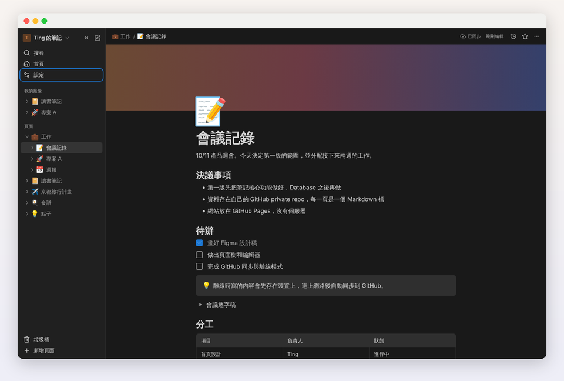
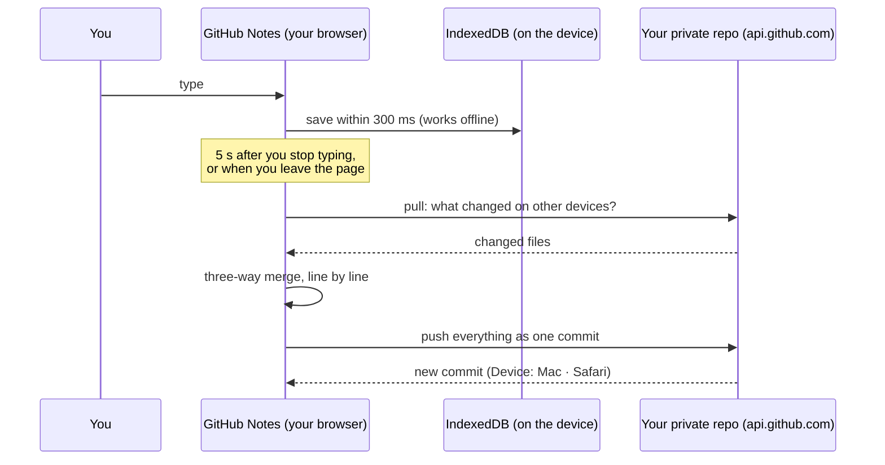

<div align="center">

# GitHub Notes

**像 Notion 一樣好寫的筆記，存在你自己的 GitHub。**<br>
A Notion-style notes app that keeps every page as a Markdown file in your own private GitHub repo.<br>
No server. No sign-up. Works offline, on your computer and your iPhone.

[**Open the app →**](https://tinggeorge.github.io/notion-like-web-app/) · [Spec](SPEC.md) · [Illustrated spec](SPEC.html)



</div>

## Why GitHub Notes

| | |
| --- | --- |
| **Your notes, your repo** | Every page is a plain `.md` file in a private repository you own. Read them on github.com, clone them, grep them, keep them forever. |
| **No server, no account** | The app is a static site. It talks only to `api.github.com`, with a token that can reach your notes repo and nothing else. |
| **Feels like Notion** | Block editor, `/` menu, Markdown shortcuts, colours, toggles, callouts, tables, Notion's keyboard shortcuts. |
| **Offline first** | Everything is kept on the device. Write on a plane; it syncs when you are back online. |
| **Computer and iPhone** | Add it to the iPhone home screen and it behaves like an app. Move to a new device by scanning a QR code, or by typing a code. |
| **History for free** | Every sync is a git commit, so every version of every page is in your repo's history. |

## Features

### Write like in Notion

Headings, lists, to-dos, toggles, quotes, callouts, code, tables, images, files and links to other pages. Type `/` for any block, or use Markdown shortcuts as you type (`# `, `- `, `[] `, `> `, ```` ``` ````…). Drag either side of an image to resize it, or crop it with 裁切圖片; github.com shows it the same way.



### Find anything, in Chinese too

`⌘K` searches titles, headings and text across all pages, with proper Chinese word segmentation. Results come back in about 30 ms with 1,000 pages.



### Built for the iPhone

A layout of its own: tab bar, large titles, bottom sheets, and a toolbar above the keyboard for inserting blocks.



### Two devices, one set of notes

Edits from different devices merge line by line. If both changed the same line, you see both versions and choose; nothing is thrown away (the other version goes to the trash, and git keeps everything).



### Add a device with a QR code, or a code

On a device that is already set up: 設定 → 連結新裝置 → 顯示 QR code, and scan it on the new device. The token inside the QR code is encrypted.

No camera on the new device? Choose 「新裝置沒有相機？改用配對碼」 instead, and type the GitHub account and the 10-character code it shows on the new device (「沒有相機？用配對碼連結」). The encrypted setup waits for a few minutes in a public gist of your account and is deleted as soon as the new device has it, so the token needs the *Gists: Read and write* permission for this.



### Light and dark

Follows the system, or switch with `⌘⇧L`. Colours meet WCAG AA contrast in both themes.



### Everything else you would expect

- A page tree with drag and drop, 移動到…, duplicate and delete
- Renaming or moving a page rewrites every link to it in the same commit
- 垃圾桶 (trash) with restore; pages stay in git history even after 永久刪除
- 頁面歷史: browse any earlier version of a page and restore it
- 我的最愛, 最近造訪, backlinks, page icons and covers
- Export a page as Markdown, print or save as PDF
- IME-safe: Chinese, Japanese and Korean input never trigger shortcuts mid-composition
- Installable PWA; the whole UI is in Traditional Chinese

## How it works


The app is only code. Your notes travel directly between your device and your repo:



### What a page looks like on GitHub

A page called 會議記錄 inside 工作 is the file `工作/會議記錄.md`:

```markdown
---
id: 01JA8Z3K5N6P7Q8R9S0T1V2MTG
icon: "📝"
---
10/11 產品週會。今天決定第一版的範圍。

## 待辦

- [x] 畫好 Figma 設計稿
- [ ] 做出頁面樹和編輯器

> [!TIP]
> 離線時寫的內容會先存在裝置上，連上網路後自動同步到 GitHub。
```

Sub-pages live in a folder with the same name as their parent, images go to `_assets/`, and app settings (favourites, page order, trash) live in `.notes/`. Callouts use GitHub's alert syntax, so they render nicely on github.com too. The full format is in [SPEC.md §3](SPEC.md#3-repository-data-format).

## Get started

1. **Create a private repo** for your notes on GitHub, for example `notes`. It can be empty.
2. **Open the app** and press 開始設定. Use 「在 GitHub 建立 token ↗」 to open a pre-filled token form, then under *Repository access* choose **Only select repositories** → your notes repo. The only permission you need is *Contents: Read and write* (GitHub adds read-only *Metadata* by itself); add *Gists: Read and write* under *Account permissions* if you want to link devices by typing a code.
3. **Paste the token** and its expiry date (tick 「永不過期」 for a token created with *No expiration*), pick the repo, and wait for the first sync. An empty repo starts with a 歡迎使用 page.
4. **On iPhone**, open the app in Safari → Share → 加入主畫面, then use 「用 QR code 從另一台裝置連結」 and scan the code shown on your computer.

The token is stored only on your device, is never sent anywhere except `api.github.com`, and never appears in URLs, logs or exports.

## Keyboard shortcuts

On Windows and Linux, `⌘` is `Ctrl`.

| Shortcut | Action | Shortcut | Action |
| --- | --- | --- | --- |
| `⌘K` / `⌘P` | Search | `⌘⌥N` | New page |
| `⌘K` on a selection | Add a link | `⌘\` | Show or hide the sidebar |
| `⌘B` `⌘I` `⌘U` | Bold, italic, underline | `⌘⇧L` | Dark mode |
| `⌘⇧S` / `⌘E` | Strikethrough / inline code | `⌘[` / `⌘]` | Back / forward |
| `⌘⌥0` … `⌘⌥8` | Turn into text, H1–H3, to-do, list, toggle, code | `⌘Enter` | Check a to-do, open a toggle |
| `⌘D` | Duplicate block | `⌘⇧↑` / `⌘⇧↓` | Move block |

The full list, with the Markdown shortcuts, is in [SPEC.md §7.1](SPEC.md#71-keyboard-shortcuts-notion-parity).

## Privacy and security

- No backend and no analytics. The only network calls are to `api.github.com` (and the app's own files).
- A strict Content Security Policy, and the app refuses to run inside a frame.
- Use a **fine-grained** token limited to your notes repo; a classic token is accepted only after a warning.
- Notes are not encrypted inside the repo: keep the repo private.

## Limitations (v1)

- One person, many devices. No real-time co-editing, sharing or comments.
- No databases (table, board and calendar views).
- Empty paragraphs are not kept when the page is saved: Markdown has no way to write them.
- Pages over 1 MB and attachments over 25 MB get a warning.
- Tested on Safari 17+, Chrome/Edge 120+, Firefox 125+ and iOS 17+. Android should work but is not tested.

## Development

Requires Node 22.

```sh
npm ci
npm run dev          # http://localhost:5173
npm run check        # lint + typecheck + unit tests
npm run e2e          # end-to-end tests (Playwright) against a production build
npm run build        # static files in dist/
```

Tests never touch the real GitHub: unit and end-to-end tests run against an in-memory fake GitHub API (`test/fake-github/`) that keeps real git objects. CI runs lint, typecheck, about 640 unit tests and about 230 end-to-end tests on Chromium, WebKit and Firefox at desktop and iPhone sizes, including automated accessibility checks. A push to `main` deploys to GitHub Pages after everything passes.

| Folder | What |
| --- | --- |
| `src/lib/markdown/` | Markdown ⇄ editor document, frontmatter, link rewriting |
| `src/lib/sync/` | Sync engine: pull, three-way merge, push, conflicts, retries |
| `src/lib/github/` | GitHub REST and GraphQL client |
| `src/lib/store/`, `src/lib/workspace/` | On-device storage (IndexedDB) and page operations |
| `src/lib/search/` | Search index with Chinese word segmentation |
| `src/editor/` | The block editor (ProseMirror) |
| `src/app/` | Screens and layouts for desktop and iPhone |
| `src/strings/zh-TW.ts` | Every UI string |
| `e2e/` | End-to-end tests |

Design: the Figma file covers 15 desktop screens (D01–D15) and 22 iPhone screens (M01–M22). [SPEC.md](SPEC.md) is the source of truth for behaviour; requirement IDs such as `SYNC-7` are referenced in code and tests.

## License

[MIT](LICENSE)
