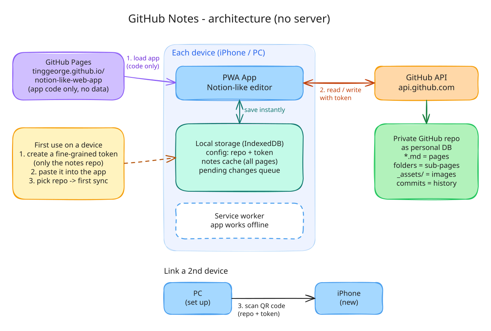

# GitHub Notes — Spec v0.2

A Notion-like notes app that runs entirely in the browser (a PWA) and stores every page as a Markdown file in the user's own private GitHub repository. There is no server.

- **Related documents**:
  - Plan and decision log (zh-TW): [`TingGeorge/ideas` → `github-notes/README.md`](https://github.com/TingGeorge/ideas/blob/claude/bold-sagan-uthv65/github-notes/README.md)
  - Visual companion: [`SPEC.html`](SPEC.html), the same spec as diagrams, with the full requirement text in collapsible panels. Open it in a browser. This file stays the source of truth.
  - Design: [Figma](https://www.figma.com/design/N3TDXtJeqjUd6wiUBHPzNu/Untitled). Screen codes `D01`–`D15` (desktop) and `M01`–`M22` (iPhone) refer to frames in that file.
  - Links to other repos point at the working branch `claude/bold-sagan-uthv65` until it is merged.
- **How to read this spec**: requirement IDs (`DATA-3`, `SYNC-7`, …) are referenced by tests. "MUST" is required for v1; "SHOULD" may slip to a later release.

**Changes since v0.1** (from a review against GitHub's documentation and live API responses):
- **Token expiry**: browsers cannot read the token-expiry header, so setup asks for the date.
- **Write access**: it is checked with a real write probe.
- **Push**:
  - deletes only paths that exist;
  - remembers the exact snapshot it pushed;
  - computes blob SHAs locally.
- **Rate limits**: the first sync uses GraphQL, and pushes are spaced to respect GitHub's secondary limits.
- **Links**: links and images are root-relative.
- **QR linking**: protected by a pairing code.
- **Shortcuts**: browser-safe new-page shortcut.
- **Added**:
  - rules for moves, deletes, identical new paths, open editors and IME input;
  - iPhone screens M17–M22.

## 1. Scope

| In scope (v1) | Out of scope (v1) |
| --- | --- |
| One user, many devices, one repo per device setup | Real-time multi-user editing, sharing, comments, @people |
| Desktop browsers: Safari 17+, Chrome/Edge 120+, Firefox 125+ | Databases (table/board/calendar views), templates, formulas |
| iPhone: iOS 17+ home-screen web app | Importing a Notion export (the file format is kept compatible so it can be added) |
| Offline reading and writing, automatic sync | Android-specific polish (it should work, but it is not tested) |
| Notion-style editing, shortcuts, colours, search | Encryption of notes inside the repo |
| Traditional Chinese UI, and English (NFR-4) | Other UI languages (each is one strings file) |

## 2. Architecture



Editable source: [`docs/architecture.excalidraw`](docs/architecture.excalidraw). Open it in Excalidraw, then export it again to `docs/architecture.svg`.

Modules inside the app:

```
┌──────────────── Device (iPhone / PC) ────────────────┐
│  UI (React) ── Editor (ProseMirror)                   │
│     │                                                 │
│  Store (IndexedDB / Dexie): config, files, index      │──▶ works offline
│     │                                                 │
│  Sync engine ── GitHub client (REST + GraphQL)        │
│  Search index (MiniSearch + Intl.Segmenter)           │
│  Service worker (app shell cache)                     │
└────────────┬──────────────────────────┬───────────────┘
             │ app code only            │ token, HTTPS
             ▼                          ▼
   GitHub Pages                    api.github.com ──▶ user's private repo
   tinggeorge.github.io/notion-like-web-app/
```

The editor is built directly on ProseMirror, the engine Milkdown wraps, with remark (mdast) for parsing and `mdast-util-to-markdown` for writing. The Markdown mapping in §3.4 is custom (toggles, callouts, colours, byte-for-byte unknown blocks), so the app owns that layer instead of adapting Milkdown's presets.

- **ARCH-1** The app is static files served from GitHub Pages.
  - It is built with a relative base (`base: "./"`), so the same build works under `/notion-like-web-app/` or at the root of a custom domain (SEC-6).
  - It MUST NOT depend on any server other than `api.github.com`.
- **ARCH-2** Routing uses the URL hash (`#/…`), so GitHub Pages never returns 404 for deep links. Routes:

  | Route | Screen |
  | --- | --- |
  | `#/` | home |
  | `#/p/<pageKey>` | page |
  | `#/search?q=` | search |
  | `#/settings/<section>` | settings |
  | `#/setup/<step>` | setup |
  | `#/link` | link a device |
- **ARCH-3** All network calls go to `https://api.github.com`: the REST API and `/graphql`. The token MUST NOT be sent anywhere else. A device that is not linked yet reads the link gist of LINK-5 there without a token.
- **ARCH-4** No third-party scripts, fonts or analytics are loaded at runtime. Libraries are bundled at build time.
- **ARCH-5** Fonts and colours:
  - UI text uses the system font stack `-apple-system, BlinkMacSystemFont, "PingFang TC", "Microsoft JhengHei", "Noto Sans TC", "Segoe UI", sans-serif`.
  - Code uses `ui-monospace, SFMono-Regular, Menlo, Consolas, monospace`.
  - Figma uses Noto Sans TC and JetBrains Mono as stand-ins.
  - Colours come from the Figma variables. They are exported as CSS custom properties (`--bg-default`, `--text-primary`, …) with light and dark values.

## 3. Repository data format

The repo is the source of truth. It must stay readable on github.com and usable by other Markdown tools.

### 3.1 Workspace and reserved names

- **DATA-1** A workspace is `(owner, repo, branch)`. The branch is the repo's default branch at setup time.
- **DATA-2** Every `.md` file is a page, except files under reserved folders. Files that are not `.md` are ignored and never modified.
  - Reserved folders are any folder whose name starts with `.` (for example `.notes/`, `.github/`), and `_assets/` at the root.
  - Because DATA-4 removes leading dots, a page title can never produce a `.` name. A root page whose name would be exactly `_assets` is written as `＿assets` (full-width low line).

```
README.md                      ← an ordinary page if present
工作.md                         ← page 「工作」
工作/                           ← children of 「工作」
  會議記錄.md
  專案 A.md
讀書筆記.md
_assets/2026/10/3f9a2c1b.png   ← attachments
.notes/settings.json           ← favourites, sidebar order
.notes/trash/…                 ← deleted pages and replaced versions
```

### 3.2 Pages and file names

- **DATA-3** A page lives at `<dir>/<name>.md`. Its children live in the sibling folder `<dir>/<name>/`. A page with no children has no folder.
  - A non-reserved folder that has no matching `<name>.md` (common in existing repos, for example `docs/`) is shown as a **virtual page**: its title is the folder name and it has no body. The file is created only when the user edits that page.
- **DATA-4** The name comes from the title:
  - The characters `/ \ : * ? " < > |` are replaced by their full-width forms `／ ＼ ： ＊ ？ ＂ ＜ ＞ ｜`.
  - Control characters are removed.
  - Leading and trailing spaces and dots are trimmed. An empty result becomes `未命名`.
  - The name is truncated at a character boundary to 150 UTF-8 bytes.
- **DATA-5** If the file name cannot hold the exact title (DATA-4, DATA-6), the exact title is stored in the frontmatter `title`. When reading, title = `frontmatter.title`, or else the file name without `.md`.
- **DATA-6** Names are unique within a folder, compared case-insensitively after Unicode NFC normalisation. On a clash the new name gets ` (2)`, ` (3)`, … The title itself is unchanged.
- **DATA-7** Renaming or moving a page renames or moves its `.md` file and its whole child folder in one commit (SYNC-10).

### 3.3 Page file and identity

```markdown
---
id: 01JA8Z3K5N6P7Q8R9S0T1V2W3X
icon: "📝"
cover: "/_assets/2026/10/ab12cd34.jpg"
created: 2026-10-11T10:00:00+08:00
---
Body Markdown…
```

- **DATA-8** Frontmatter is YAML. Unknown keys MUST be kept verbatim and in order. Keys the app uses:

  | Key | Meaning |
  | --- | --- |
  | `id` | ULID; stable identity across renames (DATA-9) |
  | `title` | exact title, only when needed (DATA-5) |
  | `icon` | one emoji |
  | `cover` | root-relative image path, or `gradient:<1-8>` |
  | `created` | ISO 8601 |

- **DATA-9** Page key:
  - In the app, a page's key is its `id`, or `path:<repo path>` while it has none.
  - Files without frontmatter (for example created on github.com) are valid. Opening or syncing such a file MUST NOT rewrite it.
  - The app writes `id` (and `created`) the first time it saves the page, and also when an action needs a stable id: favouriting, reordering, copying a link, or trashing. This is the only exception to the no-rewrite rule.
- **DATA-9a** Duplicate ids (a file copied on github.com, 複製頁面, conflict copies):
  - Copies made by the app always get a new ULID.
  - If a pull finds two files with the same `id`, the file with the lexicographically smaller path keeps it. The other is treated as having no id until it is next saved, when it gets a new one.
  - Move detection (SYNC-5) ignores ids that appear more than once.
- **DATA-10** Files are UTF-8 with LF line endings and one trailing newline. The page title is not repeated as a heading in the body.

### 3.4 Blocks ↔ Markdown

The editor document is converted to and from Markdown (CommonMark 0.31 + GFM) as follows.

| Block (Notion name) | Markdown written |
| --- | --- |
| Text | the paragraph |
| Heading 1 / 2 / 3 | `# ` / `## ` / `### ` |
| Bulleted list | `- item` |
| Numbered list | `1. item`, `2. item`, … |
| To-do | `- [ ] item` / `- [x] item` |
| Toggle | `<details>` / `<summary>Title</summary>`, blank line, children, blank line, `</details>` |
| Quote | `> text` |
| Callout | GitHub alert `> [!NOTE]` / `[!TIP]` / `[!IMPORTANT]` / `[!WARNING]` / `[!CAUTION]` + content (DATA-12) |
| Divider | `---` |
| Code | fenced block with a language: ```` ```js ```` |
| Simple table | GFM pipe table; the first row is the header |
| Image | `` alone in a paragraph; with a width (DATA-19), `` alone in a block |
| File | `[file name.pdf](/_assets/…)` alone in a paragraph |
| Link to page | `[Title](/path/Title.md)` alone in a paragraph |
| Line break inside a block | backslash at the end of the line |

| Inline (Notion) | Markdown written |
| --- | --- |
| Bold / italic / strikethrough / code | `**x**` / `*x*` / `~~x~~` / `` `x` `` |
| Underline | `<u>x</u>` |
| Link | `[x](https://…)`; to a page: `[x](/path/Page.md)` |
| Text colour / background colour | `<span data-color="red">x</span>` / `<span data-bg="yellow">x</span>` |

- **DATA-11** Colours use Notion's names: `gray brown orange yellow green blue purple pink red`. On github.com the spans show as plain text.
- **DATA-12** Callout icons map to alert types:

  | Icon | Alert type |
  | --- | --- |
  | 💡 | `TIP` |
  | ⚠️ | `WARNING` |
  | ❗ | `IMPORTANT` |
  | 🛑 | `CAUTION` |
  | anything else | `NOTE` (default icon ℹ️) |

  A non-default icon is kept on the line `<!-- icon: 🧠 -->` right after the marker.
- **DATA-13** Nesting:
  - Children are allowed under list items, to-dos and toggles.
  - Child lines are indented by the width of the parent's marker: 2 spaces under `- `, `len("N. ")` under a numbered item (3 for `1.`–`9.`, 4 for `10.`–`99.`).
  - Callouts can only be top-level blocks, because GitHub cannot render alerts inside other elements. Pasting a callout into a list turns it into a quote.
  - `Tab` on a paragraph or heading does nothing. Markdown cannot express that, so this is a documented deviation from Notion.
- **DATA-14** Editor schema limits:
  - Headings and table cells hold inline content only, with no line breaks.
  - Code blocks hold plain text.
  - Marks are written in a fixed outer-to-inner order: background span → colour span → link → bold → italic → strikethrough → underline → inline code.
- **DATA-15** Markdown the editor does not understand MUST be kept byte-for-byte: raw HTML blocks, footnotes, math, HTML comments other than DATA-12. It is shown as an editable "Markdown" block.
- **DATA-16** Round trip:
  - `parse(serialize(doc)) == doc` for every document the editor can produce.
  - `serialize(parse(md)) == md` for Markdown written by the app.
  - Other styles (such as `*` bullets) are normalised only when the user edits that page.
- **DATA-17** Internal links and attachment paths are **root-relative** (start with `/`). github.com resolves those from the repository root, and they keep working when the linking page moves.
  - In paths, these characters are percent-encoded: space, `%`, `(`, `)`, `<`, `>`, `#`, `?`, `[`, `]`. Everything else, including Chinese, stays as is.
  - When a page or folder moves, every link to it or to any page inside it is rewritten in the same commit.
  - Backlinks come from the local index (STORE-4).

### 3.5 Attachments

- **DATA-18** An uploaded file is stored at `_assets/<YYYY>/<MM>/<SHA-256 hex prefix>.<ext>`, using the first 8 hex characters. If that path already holds different content, the prefix is lengthened by 4 characters until it is unique. An existing file is never overwritten.
- **DATA-19** Images:
  - An image longer than 2560 px on its long edge is scaled down before upload.
  - It is re-encoded as JPEG quality 0.85 unless it has transparency, in which case it stays PNG.
  - Any file over 25 MB is rejected with an explanation.
  - **Resize** (as in Notion): dragging either side of an image sets its display width, in CSS pixels from 40 to 4000 and at most the page width.
    - The width is written as `` (plus `title="…"` if the image has one), alone in a block, so github.com shows the same size. Markdown cannot express a width.
    - The parser accepts `` with `src`, `width` and optionally `alt` and `title`, in any order and quoting. Any other `` stays raw (DATA-15).
    - Dragging back to the size the image shows without a width removes the width (`` again).
    - A nested list or a callout's text after such an image is separated by a blank line, because an HTML block runs until one.
  - **Crop**: the 「裁切圖片」 button on the image opens a crop frame with corner and edge handles; dragging inside moves it.
    - 「完成」 draws the kept part at full resolution and uploads it as a new attachment, re-encoded as above. The block then points at it and keeps its scale on the page.
    - The original stays in the repo (DATA-20), and ⌘Z points the block back at it.
    - `https:` images cannot be cropped, because the browser does not let a page read their pixels.
- **DATA-20** Deleting a page does not delete its attachments. Cleaning up orphans is out of scope for v1.

### 3.6 Settings and trash

- **DATA-21** `.notes/settings.json`:

  ```json
  { "version": 1,
    "favorites": ["<pageKey>", "…"],
    "order": { "root": ["<pageKey>", "…"], "<parentKey>": ["<pageKey>", "…"] },
    "trashRetentionDays": 30 }
  ```

  Children listed in `order` come first, in that order. The rest follow by title (`Intl.Collator("zh-TW")`).
- **DATA-22** Trash. `.notes/trash/index.json` has entries `{ id, title, originalPath, deletedAt, reason }`, where `reason` is `deleted` or `replaced`.
  - Deleting a page moves its file and its child folder to `.notes/trash/<id>/` and adds an entry with `reason: "deleted"`.
  - A version discarded in a conflict (SYNC-6) is saved the same way with `reason: "replaced"`.
  - Restoring moves the files back (DATA-6 if the name is taken).
  - 「永久刪除」 removes them from `.notes/trash/`. They stay in git history.
  - On sync, entries older than `trashRetentionDays` are removed permanently.

## 4. Device storage

- **STORE-1** One IndexedDB database `github-notes` (Dexie), with schema versions and migrations:

  | Table | Key | Contents |
  | --- | --- | --- |
  | `config` | key | `workspace` `{owner, repo, branch, token, tokenExpiresOn (YYYY-MM-DD or null), login, linkedAt}`, `device` `{id, name}`, `ui` `{theme, sidebarWidth, collapsed, recent[], lastColor}`, `linkGist` `{id, createdAt}` (LINK-5) |
  | `files` | path | `kind` (`page` / `meta`), `baseSha`, `baseText`, `text`, `pushing` (snapshot text or null), `dirty`, `deleted`, `conflict`, `updatedAt` |
  | `uploads` | path | attachments not yet pushed: `blob`, `sha256`, `createdAt`. Never evicted |
  | `pages` | pageKey | derived: `path`, `title`, `icon`, `parentKey`, `links[]`, `excerpt`, `updatedAt`. Can always be rebuilt from `files` |
  | `assets` | path | downloaded attachments: `blob`, `size`, `lastUsed`. A cache of at most 200 MB, least-recently-used eviction |
  | `sync` | key | `headSha`, `treeSha`, `etag`, `lastPullAt`, `lastPushAt`, `lastPushStartedAt`, `lastError` |
  | `search` | key | the serialised MiniSearch index |

- **STORE-2** `baseText` / `baseSha` are the file as last seen on GitHub. `text` is the local version. `dirty = text !== baseText || deleted`.
- **STORE-3** Every edit is written to `files.text` within 300 ms of the last keystroke and before the page is left. Network state and app closure never lose an edit.
- **STORE-4** The `pages` index and the search index are updated from `files` on every local write and every pull.
- **STORE-5** After setup the app calls `navigator.storage.persist()`.
- **STORE-6** Several tabs share the database.
  - They exchange changes through `BroadcastChannel`.
  - Only one tab syncs at a time, using the Web Locks API (`navigator.locks.request("sync")`).
- **STORE-7** The token is stored in plain text in IndexedDB (see §8). It never appears in logs, URLs, error messages or exports.

## 5. Sync

### 5.1 Principles

- **SYNC-1** The remote branch head is the truth. The device keeps the commit it last synced (`headSha`) plus local changes.
- **SYNC-2** No text is ever lost. Every version that existed on a device or on GitHub survives somewhere: in the page, in a conflict copy, in the trash (DATA-22) or in git history.
- **SYNC-3** Only one pull or push runs at a time per device (STORE-6). Before each one, the open editor is flushed into `files.text` while the sync lock is held.

### 5.2 Pull

- **SYNC-4** A pull runs:
  - at app start;
  - when the window becomes visible;
  - every 60 s while visible;
  - before every push;
  - on 「立即同步」.
- **SYNC-5** Steps:
  1. `GET /repos/{o}/{r}/git/ref/heads/{b}` with `If-None-Match: <etag>`. Stop if the response is `304` or the ref equals `headSha`.
  2. `GET /repos/{o}/{r}/git/trees/{treeSha}?recursive=1`. If it is `truncated`, report "repo too large" (out of scope).
  3. Download every page or meta file whose blob SHA differs from `baseSha`:
     - up to 20 files: `GET /git/blobs/{sha}`, at most 2 at a time; the content is base64, decoded with `TextDecoder`;
     - more than 20 files: GraphQL, about 100 blobs per query (`object(oid:"…") { ... on Blob { text byteSize isBinary } }`).
  4. Apply the changes in this order:
     1. **Moves.** The same `id` at a new path, outside `.notes/trash/` and not duplicated (DATA-9a), is a move. Local edits are applied to the new path by three-way merge.
     2. **Moves into `.notes/trash/`.** These count as deletes (rule 3).
     3. **Deletes.** A remote delete of a clean local file deletes it locally. If the local file is dirty, the local version is kept and re-created by the next push, with the notice 「這一頁在另一台裝置被刪除，但這台裝置有修改，所以保留了。」
     4. **Edits.**
        - Clean locally: take the remote text.
        - Dirty locally: three-way merge by line (node-diff3) with base = `baseText`, ours = `text`, theirs = remote. Frontmatter is merged key by key, the body by line. A clean merge sets `text = merged` and `baseText = remote`. Overlapping changes go to SYNC-6.
     5. **Adds.** A new remote path is added locally. If an unpushed local page already uses that path, the local page is renamed per DATA-6 first.
     6. **Local move or delete against a remote edit.**
        - Local move, remote edit at the old path: the remote edit is merged into the moved file, matched by id.
        - Local delete, remote edit: the remote text is put into the local trash entry, with the notice 「你刪除的頁面在另一台裝置有新的修改，已一起放進垃圾桶。」
     7. Set `headSha`, `treeSha` and `etag`.
  5. Pages that are open in this or another tab (BroadcastChannel) show the new content right away:
     - If the open page was clean, the editor content is replaced and the cursor is kept at the same block and offset.
     - If it was dirty, the merge result is applied the same way.

### 5.3 Conflicts

- **SYNC-6** An overlapping edit marks the page `conflict` and shows a banner. The rest of the workspace keeps syncing; pushes for that page are held until the user chooses (D10 / M20).
  - **The dialog**:
    - Shows both versions with the changed text highlighted.
    - Names the other side from the `Device:` trailer of the latest remote commit that touched the file (SYNC-9). Without a trailer (for example an edit on github.com) it says 「GitHub 上的版本」.
  - **Choices**:

    | Choice | What happens |
    | --- | --- |
    | 「兩個都保留」 (default) | The remote version stays in place. The local version becomes a sibling page `<title>（衝突副本 <this device> <time of the local edit HH:mm>）`. |
    | 「使用這台裝置的版本」 | The local version wins. The remote version goes to the trash with `reason: "replaced"`. |
    | 「使用 <other device> 的版本」 | The remote version wins. The local version goes to the trash with `reason: "replaced"`. |

  - If another remote change arrives while the dialog is open, the merge runs again against it. The dialog updates, or closes if the conflict is gone.
- **SYNC-6a** `.notes/settings.json` and `.notes/trash/index.json` never raise a conflict. They are merged key by key against base:

  | Key | Merge rule |
  | --- | --- |
  | `favorites` | union, minus entries removed on either side since base |
  | `order` | local wins for each parent key |
  | trash entries | union by `id`, minus entries removed on either side since base |
  | `trashRetentionDays`, `version` | local wins |

  Remote JSON that does not parse is ignored and the local file is kept, with a notice.

### 5.4 Push

- **SYNC-7** Push triggers and throttling:
  - A push runs 5 s after the last edit, but at most once every 30 s.
  - It also runs when leaving a page, when the app is hidden (best effort) and on 「立即同步」. These ignore the 30 s spacing.
  - A page whose title and body are both empty is never pushed.
  - When 「自動同步」 in settings is off, there are no automatic pushes at all (timer, leave, hide). Only 「立即同步」 pushes. Pulls keep running.
- **SYNC-8** Steps (Git Data API, one commit per push):
  1. Pull (SYNC-5), so the base is the current head.
  2. For each dirty file, record the exact text being pushed in `pushing`.
  3. Upload each new attachment from `uploads`: `POST /git/blobs` (base64).
  4. `POST /git/trees` with `base_tree` = the head tree:
     - an entry with inline `content` for each changed text file;
     - an entry with the blob SHA for each attachment;
     - an entry with `sha: null` for each deletion, but **only for paths that exist in the head tree from step 1**. A deleted local file whose path is not in that tree is marked clean without a tree entry.
  5. `POST /git/commits` with `parents: [headSha]`.
  6. `PATCH /git/refs/heads/{b}` with `force: false`.
     - On `422` or `409`, go back to step 1.
     - After 3 failed attempts, show the Error state.
  7. On success, for each pushed file:
     - set `baseText = pushing`;
     - compute `baseSha` locally as the git blob SHA-1 of `"blob <len>\0" + bytes` (WebCrypto);
     - clear `pushing`; the file stays dirty if `text !== pushing`.

     Then set `headSha` and delete the pushed `uploads` rows.
- **SYNC-9** Commit message, in the UI language:

  ```
  更新「會議記錄」          ← or 更新 3 頁 / 新增「x」 / 移動「x」 / 刪除「x」 / 上傳圖片
                             ← blank line
  Device: iPhone · Safari
  App: GitHub Notes 0.1.0
  ```

  The device name comes from the user agent (`iPhone`, `iPad`, `Mac`, `Windows 電腦`, `Linux 電腦`, `Android`) plus the browser.
- **SYNC-10** A rename or move is one local operation and goes out in one push, with a message such as 「移動「專案 A」到「工作」」. It covers:
  - deleting and adding the page file and every file in its folder;
  - rewriting inbound links (DATA-17);
  - updating `.notes/settings.json`.

### 5.5 Status, errors and limits

- **SYNC-11** Sync/Status shows one of these states:

  | State | When |
  | --- | --- |
  | 已同步 | nothing dirty and the last pull succeeded |
  | 同步中… | a pull or push is running |
  | 離線 · N 頁待同步 | no network; N dirty pages |
  | 同步失敗 · 點此重試 | any other error |

  Tapping the error state shows the reason: 「token 無效或已過期」, 「token 沒有寫入權限」, 「GitHub 暫時無法使用」, 「找不到 repo」, 「GitHub 要求暫停一下」, …
- **SYNC-12** Network failures retry with exponential backoff (5 s → 5 min), and immediately on the browser `online` event.
- **SYNC-13** Rate limits (GitHub REST best practices):
  - The app reads `x-ratelimit-remaining`. Below 200, polling (SYNC-4) stops until `x-ratelimit-reset`.
  - Secondary limit (`403` or `429`): wait for `retry-after` if present. Without it, wait 60 s, then back off exponentially.
  - Requests are made serially, except the 2-way blob downloads in SYNC-5.
  - SYNC-7's spacing keeps content-creating requests (three per push) under GitHub's 500 per hour.
- **SYNC-14** Limits for v1: up to 5,000 pages, 1 MB per page, 25 MB per attachment. Above these limits the app warns and keeps working where it can.

### 5.6 Page history (D06 / M18)

- **SYNC-15** Versions come from `GET /repos/{o}/{r}/commits?path=<path>&per_page=30`, paged. Each row shows the date, time and `Device:` trailer.
  - The preview loads `GET /repos/{o}/{r}/contents/<path>?ref=<sha>` with `Accept: application/vnd.github.raw`, which also works for files over 1 MB.
  - 「還原這個版本」 replaces the local text with that version as a normal edit.
- **SYNC-16** History starts at the page's latest move or rename. The REST API does not follow renames; this is a known limitation.

## 6. Setup and device linking

### 6.1 First run

- **SETUP-1** With no `workspace` in config, the app shows D01/M01 (歡迎) and the main UI is not reachable.
- **SETUP-2** On iOS, when not running as a home-screen app (`navigator.standalone !== true`), the app shows M16 (加入主畫面) first. Reason: Safari and home-screen apps have separate storage. 「仍要在 Safari 使用」 continues anyway (see SETUP-13).

### 6.2 Connect GitHub (D12 / M12)

- **SETUP-3** Links on this screen:
  - 「在 GitHub 新建 repo ↗」 opens `https://github.com/new`.
  - 「在 GitHub 建立 token ↗」 opens a pre-filled form: `https://github.com/settings/personal-access-tokens/new?name=GitHub+Notes&description=GitHub+Notes+app&contents=write&expires_in=90`.
  - URL parameters cannot pick the repository, so the steps on screen still say: Repository access → 「Only select repositories」 → the notes repo.
- **SETUP-4** Accepted token formats (leading and trailing whitespace is removed):

  | Input | Result |
  | --- | --- |
  | `github_pat_…` (fine-grained) | accepted |
  | `ghp_…` (classic personal token) | accepted after a warning that it can reach all of the user's repos |
  | anything else | rejected inline: 「這看起來不是 GitHub token」 |

- **SETUP-5** Expiry date. Browsers cannot read GitHub's token-expiry response header (it is not CORS-exposed), so the screen asks for 「到期日」.
  - The default is today + 90 days, which matches the pre-filled form.
  - 「永不過期」 is for a token created with GitHub's 「No expiration」. It disables the date, which is then neither required nor checked, and stores `tokenExpiresOn: null`. Such a token gets no expiry banner (SETUP-13); a `401` still makes the app read-only.
  - The value is stored as `tokenExpiresOn` and can be edited in settings, which show 「YYYY/MM/DD 到期」 or 「永不過期」.
- **SETUP-6** On 「連結」:
  1. `GET /user` gives the login. A `401` shows 「token 無效或已過期」.
  2. `GET /user/repos?per_page=100&sort=updated`, paged, lists candidate repos.
  3. Go to D13.

### 6.3 Choose repo (D13 / M13)

- **SETUP-7** The list shows candidate repos with Private and Public badges. Choosing a public repo needs a confirmation: 「公開的 repo 任何人都看得到你的筆記」.
- **SETUP-8** After a repo is chosen, write access is probed with `POST /repos/{o}/{r}/git/blobs {"content":"github-notes write check","encoding":"utf-8"}`. The `permissions` field of the repo list is not used, because it describes the user, not the token.

  | Response | Meaning |
  | --- | --- |
  | `201` | OK. The blob is unreferenced and harmless. |
  | `403` / `404` | 「這把 token 沒有這個 repo 的寫入權限（Contents: Read and write）」 |
  | `409` | The repo is empty. SETUP-9 initialises it, and that write is itself the probe. |

- **SETUP-9** An empty repo is initialised with one commit, `PUT /repos/{o}/{r}/contents/歡迎使用.md`, a page that explains the basics. A non-empty repo is used as it is. Its `.md` files become pages, and its folders without a page become virtual pages (DATA-3).

### 6.4 First sync (D14 / M14)

- **SETUP-10** The app downloads every page (SYNC-5) with a progress bar showing files done out of the total, then builds the search index. 「開始使用」 is enabled when both are done. Attachments download lazily when first shown.

### 6.5 Link a new device (D15 → M15 → M22)

- **LINK-1** Payload and encryption:
  - The source device creates:
    - an 8-character **pairing code** from the alphabet `23456789ABCDEFGHJKMNPQRSTUVWXYZ`, shown as `XXXX-XXXX`;
    - the payload `ghnotes:1:<salt>.<iv>.<ciphertext>`, all base64url.
  - The ciphertext is AES-GCM of the UTF-8 JSON `{"o","r","b","t","e"}` (owner, repo, branch, token, `tokenExpiresOn`). A token that never expires is sent as `"e":"9999-12-31"`, a date that older versions accept, and read back as `null`.
  - The key is PBKDF2-SHA-256 of the pairing code, 600,000 iterations, 16-byte salt.
  - The QR code carries the payload followed by `.` and the pairing code (`ghnotes:1:<salt>.<iv>.<ciphertext>.<CODE>`), so scanning needs nothing typed. The setup code (LINK-2) is the payload alone.
  - QR error correction is level M.
- **LINK-2** On the source device: 設定 → 連結新裝置 → 「顯示 QR code」.
  - The QR code appears only after that click, with the warning 「QR code 等於你的 token，不要給別人看或拍下來。」
  - It hides after 60 s and when the window is hidden. 「重新產生」 makes a new salt and code.
  - 「複製設定碼」 copies the encrypted payload (without the pairing code) as text, with a warning that clipboard history and Universal Clipboard can keep it. Only then is the pairing code shown, for typing on the new device.
- **LINK-3** On the new device: 「用 QR code 從另一台裝置連結」 opens the camera (`getUserMedia`, rear camera, M15). Frames are decoded with jsQR.
  1. A `ghnotes:1:` payload leads to M22. A QR code's own pairing code decrypts it at once; a pasted setup code asks the user for the pairing code. A QR code whose pairing code does not decrypt it shows 「這不是 GitHub Notes 的 QR code」.
  2. After decryption, M22 shows the owner, repo, GitHub login (`GET /user`) and expiry date (or 「token 永不過期」), and asks for confirmation.
  3. Then SETUP-8's write probe runs, and the app goes to D14/M14.
  - Any other QR content shows 「這不是 GitHub Notes 的 QR code」.
  - Three wrong pairing codes in a row discard the scanned payload.
- **LINK-4** If the camera is denied or unavailable, 「改用設定碼」 (M15) accepts the pasted payload, and the flow continues at M22.
- **LINK-5** Linking by typing, for a new device that cannot scan (no camera, or a broken one):
  - **Why a gist**: there is no server, and the new device has no token yet, so the only place both devices can reach is a public gist of the user's account on `api.github.com` (ARCH-3).
  - **Source device**: 連結新裝置 → 「新裝置沒有相機？改用配對碼」.
    - It creates a 10-character code from the LINK-1 alphabet, shown as `XXXXX-XXXXX`, and encrypts the LINK-1 payload with it (same key derivation).
    - It deletes earlier link gists, then `POST /gists` one public gist: description `GitHub Notes: device link (deleted automatically)`, file `github-notes-link.txt` holding the payload.
    - It shows the GitHub login and the code, the warning 「帳號加上配對碼等於你的 token，不要給別人看。」 and a 5-minute countdown. They stay while the window is hidden, because the phone may lock while the user types on the other device.
    - Every 3 s it checks the gist; once the new device has deleted it, it shows 「新裝置已取得設定」.
    - It deletes the gist when the code expires, is replaced (「重新產生」), or the dialog closes. The gist id is kept in `config.linkGist`, so a gist left by an app that was closed meanwhile is deleted at the next start.
    - The token needs the Gists account permission (Read and write), or the `gist` scope for a classic token. Without it, `POST /gists` answers `403` / `404`, and the dialog explains how to add it on github.com, with 「在 GitHub 編輯 token ↗」 and 「重試」.
  - **New device**: 「沒有相機？用配對碼連結」 on D01/M01, or 「改用配對碼」 on M15, asks for the GitHub account and the code.
    1. Without a token, it lists `GET /users/{login}/gists` and reads the newest three link gists with `GET /gists/{id}`. A gist made a moment ago may not be listed yet, so it looks again after 2, 4 and 6 s.
    2. It decrypts each with the code. None found: 「找不到配對碼…」. None opens: 「配對碼不正確，請再確認一次。」. Unknown account: 「找不到這個 GitHub 帳號」.
    3. It deletes the gist with the token it got, then continues at M22 (LINK-3 step 2) without asking for a code.

### 6.6 Changing the setup (D08 / M17)

- **SETUP-11** 更換 token:
  - The new token is checked as in SETUP-4 and SETUP-6, and also needs the write probe (SETUP-8) on the current repo.
  - It asks for the new expiry date, or 「永不過期」 (SETUP-5).
  - Only the token and the date are replaced.
- **SETUP-12** These actions need zero dirty files. If any exist, the user must first sync, or confirm 「放棄 N 個未同步的修改」:
  - **更換 repo**: clears `files`, `pages`, `uploads`, `assets`, `sync` and `search`, then goes to D13.
  - **中斷連結**: clears the whole database and the cache, then returns to D01/M01.
  - **清除這台裝置的資料**: clears the caches and re-downloads everything; the token and repo stay.
- **SETUP-13** Expiry and Safari tab mode:
  - **Expiry**: from 14 days before `tokenExpiresOn`, a banner says 「token 將在 N 天後到期」 with 「更換 token」. A token that never expires (`tokenExpiresOn: null`) has no such banner.
  - **Expired or revoked token**: any `401` makes the app read-only, with a banner. Local edits are kept and pushed after the token is replaced.
  - **Safari tab mode**: Safari deletes script-written data of sites the user has not used for 7 days. When the app runs as a normal Safari tab (iOS after 「仍要在 Safari 使用」, or Safari on Mac), a permanent hint suggests 「加入主畫面」 or 「加入 Dock」, and pushes ignore the 30 s spacing.

## 7. Screens and behaviour

Each Figma frame is the visual spec for its screen. This section adds the behaviour pictures cannot show. On iPhone, the screens without a desktop twin follow the D-screen behaviour.

| Code | Screen | Behaviour |
| --- | --- | --- |
| D01 M01 | 歡迎 | SETUP-1, SETUP-2 |
| D02 M03 | 頁面 | UI-1 to UI-6 |
| D03 M06 | 插入區塊 | UI-7 |
| D04 M09 | 文字格式 | UI-8 |
| D05 M07 | 搜尋 | UI-9 |
| D06 M18 | 頁面歷史 | SYNC-15, SYNC-16 |
| D07 M19 | 垃圾桶 | DATA-22; a search box filters by title; 還原 and 永久刪除 (with confirmation) |
| D08 M17 | 設定 | §6.6 and UI-15 |
| D09 M10 M11 | 深色模式 | Follows `prefers-color-scheme` unless overridden in settings |
| D10 M20 | 同步衝突 | SYNC-6 |
| D11 | 新頁面 | UI-10 |
| D12–D14 M12–M14 | 首次設定 | §6.2–§6.4 |
| D15 M21 | 連結新裝置 (show) | LINK-1, LINK-2 |
| M15 M22 | 掃描 QR code, 輸入配對碼 | LINK-3, LINK-4 |
| — | 用配對碼連結 (typing the account and code) | LINK-5 |
| M02 | 首頁 | UI-11 |
| M04 | 編輯中 | UI-12 |
| M05 | 所有頁面 | Same tree as the desktop sidebar; tap opens, long-press opens M08 |
| M08 | 頁面選單 | 加入我的最愛, 複製連結 (`#/p/<pageKey>`), 複製頁面, 移動到…, 頁面歷史, 匯出 Markdown, 列印／存成 PDF, 刪除頁面 |
| M16 | 加入主畫面 | SETUP-2 |

- **UI-1** Desktop sidebar:
  - It is 240 px wide, resizable from 200 to 480, and toggled with `⌘\`.
  - Rows drag to reorder. Dropping onto the middle of a row makes the page its child.
  - Hovering a row shows `…` (page menu) and `+` (new child page).
  - Favourites come from `settings.json`.
- **UI-2** Page header:
  - 「加入圖示」 (emoji picker) and 「加入封面」 appear on hover.
  - The title is plain text; `Enter` moves into the body.
- **UI-3** Block handle. Hovering a block shows `+` and `⋮⋮`:
  - `+` inserts a block below and opens the `/` menu.
  - Dragging `⋮⋮` moves the block.
  - Clicking `⋮⋮` opens the block menu: 刪除, 複製, 轉換成…, 顏色, 移到頁面….
- **UI-4** Top bar, left to right:
  - breadcrumb;
  - Sync/Status (SYNC-11; clicking it runs 立即同步);
  - 「已編輯 N 分鐘前」;
  - 頁面歷史;
  - 我的最愛 toggle;
  - `…`, the page menu (same items as M08).
- **UI-5** Links to pages open inside the app. External links open in a new tab with `rel="noopener noreferrer"`.
- **UI-6** A 「反向連結」 section at the bottom of a page lists the pages that link to it.
- **UI-7** The `/` menu (D03, M06):
  - **Opening**: typing `/` or the full-width `／` opens it anywhere outside code. On iPhone the same list is the M06 sheet, opened from `+` on the keyboard toolbar.
  - **Filtering**: typing filters by the Chinese name or an English alias (`text h1 h2 h3 bullet number todo toggle quote callout divider code table image file link page`), case- and width-insensitively.
  - **Closing**: the menu closes when there is no match after 3 more characters, on a space, or on `Esc`.
  - **Keys**: `↑`/`↓` move and `Enter` inserts.
  - **`page`**: creates a child page and inserts a link to it.
- **UI-8** The format toolbar (D04, M09) appears above a non-empty text selection.
  - It has: 文字 ▾ (turn into), B, I, U, S, code, link, colour, and `…`.
  - The colour menu has 預設 plus the nine Notion text colours, then 預設 plus the nine background colours.
  - The last colour used is remembered per device.
- **UI-9** Search (D05, M07):
  - **Opening**: `⌘K` with no selection, or `⌘P`.
  - **Ranking**: title matches first, then headings, then body. Each result shows its path and a snippet with the match in medium weight.
  - **Filters**: 只搜尋標題; 排序 (最相關 / 最近編輯); 日期 (any / 7 days / 30 days).
  - **Keys**: `Enter` opens the result; `⌘Enter` opens it in a new browser tab.
  - **Chinese**: the text is segmented with `Intl.Segmenter("zh-TW", {granularity: "word"})`, and single characters also match by prefix.
- **UI-10** New page:
  - `⌘⌥N`, 「新增頁面」 in the sidebar, or `+` on a row creates a local page titled 未命名 with the caret in the title (D11).
  - It is not pushed while its title and body are empty (SYNC-7). Leaving it empty discards it.
  - 「或從這裡開始」 offers built-in starter contents: 空白頁面, 待辦清單, 會議記錄範本.
- **UI-11** Home (M02):
  - **Greeting**: 早安 from 05:00 to 10:59, 午安 from 11:00 to 17:59, 晚安 otherwise.
  - **最近造訪**: the last 8 pages opened on this device.
  - **Below**: 我的最愛, then the top-level 頁面.
- **UI-12** iPhone keyboard toolbar (M04):
  - It sits above the keyboard, following `visualViewport` resizes.
  - Its buttons: `+` (M06), 轉換成, 待辦, 清單, 拍照/圖片 (`<input type="file" accept="image/*">`), 連結, 顏色, 復原, 收起鍵盤.
- **UI-13** Toasts confirm actions with no other visible result. For deletes and moves, 復原 is offered for 5 s.
- **UI-14** When a new app version is ready, the service worker shows 「有新版本 · 重新整理」. The app never reloads by itself while edits are unsaved.
- **UI-15** Settings sections:
  - **連結**: GitHub 連結, 儲存位置 / 更換 repo, GitHub token / 更換 token and the expiry date, 連結新裝置.
  - **同步與儲存**: 同步狀態 / 立即同步, 自動同步, 離線資料, 中斷連結.
  - **外觀與語言**: theme 跟隨系統 / 淺色 / 深色; language 繁體中文 (default) / English, per device. Changing the language reloads the app.
  - **鍵盤快捷鍵**: the list in §7.1.
  - **匯出**: download the whole workspace as `.zip` (bundled fflate).
- **UI-16** Printing: 「列印／存成 PDF」 in the page menu calls `window.print()`. A print stylesheet hides the app chrome. `⌘P` stays bound to search, as in Notion.
- **UI-17** Text input and IME (注音, 倉頡, …):
  - Markdown shortcuts, the `/` trigger, `Enter` handling and the save debounce MUST ignore events while `isComposing` is true. They act on `compositionend`.
- **UI-18** Paste and drop:
  - Images are uploaded as attachments (DATA-18).
  - Other files become File blocks.
  - Pasted Markdown is parsed into blocks; pasted HTML is converted (and sanitised, SEC-4); plain text becomes paragraphs.

### 7.1 Keyboard shortcuts (Notion parity)

On Windows and Linux, `⌘` is `Ctrl`, and `⌘⌥<n>` / `⌘⌥N` are `Ctrl+Shift+<n>` / `Ctrl+Alt+N`. Shortcuts with `⌥` are matched on `event.code`, because `⌥` changes `event.key` on a Mac. Browsers reserve `⌘N`, `⌘T` and `⌘W`, so new page uses `⌘⌥N`.

| Shortcut | Action |
| --- | --- |
| `⌘K` (no selection) / `⌘P` | Search |
| `⌘K` (text selected) | Add link |
| `⌘⌥N` | New page |
| `⌘\` | Toggle sidebar |
| `⌘⇧L` | Toggle dark mode |
| `⌘[` / `⌘]` | Back / forward |
| `⌘B` / `⌘I` / `⌘U` / `⌘⇧S` / `⌘E` | Bold / italic / underline / strikethrough / inline code |
| `⌘⌥0` … `⌘⌥8` | Text, H1, H2, H3, to-do, bullet, numbered, toggle, code |
| `⌘Enter` | Check a to-do; open or close a toggle |
| `⌘D` | Duplicate block |
| `⌘⇧↑` / `⌘⇧↓` | Move block up / down |
| `Tab` / `⇧Tab` | Indent / outdent (DATA-13) |
| `Esc` | Select the current block |
| `⌘Z` / `⌘⇧Z` | Undo / redo |

Markdown shortcuts, applied only after composition ends:

| Typed | Result |
| --- | --- |
| `# ` / `## ` / `### ` | Heading 1 / 2 / 3 |
| `- ` or `* ` | Bulleted list |
| `1. ` | Numbered list |
| `[] ` | To-do |
| `> ` | Toggle (as in Notion) |
| `" ` | Quote (as in Notion) |
| ```` ``` ```` | Code block |
| `---` | Divider |
| `**x**` / `*x*` / `~x~` / `` `x` `` | Bold / italic / strikethrough / inline code |

## 8. Security

- **SEC-1** Token scope. The UI and the docs tell users to create a fine-grained token with:
  - only the notes repo;
  - Contents: Read and write;
  - optionally Gists: Read and write, needed only to link devices by typing a code (LINK-5);
  - an expiry date, recommended. A token without one (「No expiration」) is accepted (SETUP-5); the docs remind users to revoke it on github.com when a device is lost.
- **SEC-2** The token is used only in the `Authorization` header of requests to `https://api.github.com`. It MUST NOT appear in URLs, logs, error reports, exports or the service-worker cache.
- **SEC-3** The Content Security Policy is set with a `<meta>` tag, because GitHub Pages cannot set headers. `<meta>` cannot carry `frame-ancestors`, so the app also refuses to run inside a frame (`if (top !== self)`).

  ```
  default-src 'self'; script-src 'self'; style-src 'self' 'unsafe-inline';
  img-src 'self' blob: data: https:; connect-src 'self' https://api.github.com;
  worker-src 'self' blob:; media-src 'self' blob: mediastream:;
  object-src 'none'; base-uri 'self'; form-action 'none'
  ```

- **SEC-4** HTML inside Markdown is sanitised with DOMPurify (bundled) before rendering. Everything else is shown as text. Allowed:
  - elements: `details`, `summary`, `span` (`data-color` and `data-bg` only), `u`, `br`, `kbd`, `sub`, `sup`;
  - link URLs: `http(s):`, `mailto:` and root-relative paths;
  - image URLs: `/_assets/…`, `blob:` and `https:`.
- **SEC-5** Attachments are fetched into `blob:` URLs. Images render only through ``. Any other file, including `.html` and `.svg`, is offered only as a download (`<a download>` with type `application/octet-stream`). The app never navigates to a `blob:` URL.
- **SEC-6** Known risk, accepted by the owner: GitHub Pages serves all of an account's project sites from one origin (`tinggeorge.github.io`), so another Pages site of that account can read this app's storage.
  - **Mitigation**: keep other Pages sites free of third-party code.
  - **Before inviting other people to use the app**, give this repo its own custom domain (for example `notes.example.com`). A custom domain on the user site would be inherited by every project site and does not isolate anything.
  - Thanks to ARCH-1 the build works at any path. Local data does not move to the new origin, so every device syncs, then sets up again.
- **SEC-7** Token sharing:
  - QR and code linking copy the same token to every device, so revoking it on github.com locks all of them. Each device then needs 更換 token, or a fresh QR link from a device that already has the new token.
  - Users who prefer separate tokens per device can skip QR linking and paste a different token on each device.
  - A lost device: revoke the token. The notes remain in the repo.
- **SEC-8** The QR code alone links a device: it carries the pairing code with the payload (LINK-1), so anyone who photographs it while it is shown can read the token. That is why it appears only on request, hides after 60 s or when the window is hidden, and carries a warning (LINK-2). The setup code is text that clipboard history can keep, so it stays encrypted with a pairing code shown only on the source device. The new device always shows which account and repo it is about to link to (LINK-3), so a planted QR code cannot silently point it at someone else's repo.
- **SEC-9** Linking by typing (LINK-5) puts the encrypted payload in a public gist for up to 5 minutes (longer only if the app is closed while the code is shown; it is then deleted at the next start), so anyone can download it while it exists. It is protected by the 10-character code (about 50 bits) and PBKDF2 with 600,000 iterations, which makes an offline search impractical. The gist is deleted by the new device as soon as it has read it, and by the source device when the code expires or is closed. The account and the code are shown only on request, with a warning, and the new device still confirms the account and repo (LINK-3).

## 9. Non-functional requirements

- **NFR-1** Performance on an iPhone 12 with 1,000 cached pages:

  | Measure | Target |
  | --- | --- |
  | cold start to an interactive page | ≤ 2 s |
  | typing latency | ≤ 16 ms per keystroke |
  | search over 5,000 pages | ≤ 100 ms |
  | first sync of 1,000 pages (GraphQL batches, SYNC-5) | ≤ 60 s |

- **NFR-2** After the first sync, everything works offline: open, read, edit, create, move, delete and search. These need the network and say so: history, attachments not yet cached, setup and linking.
- **NFR-3** Accessibility:
  - every action reachable by keyboard, with a visible focus ring;
  - WCAG AA contrast in light and dark;
  - `prefers-reduced-motion` respected;
  - VoiceOver labels on icon-only buttons.
- **NFR-4** All UI strings live in `src/strings/`: one file per language (`zh-TW.ts`, the reference, and `en.ts`, with the same keys).
  - The device's choice is kept in localStorage (it is needed before the app starts) and read once at startup.
  - Content the app writes into the repo follows the device's language: the welcome page and its path (`歡迎使用.md` / `Welcome.md`), the starter pages, new-page titles (未命名 / Untitled) and commit messages (SYNC-9). An empty new page counts as untitled in either language (UI-10).

## 10. Testing and acceptance

- **TEST-1** Unit tests (Vitest):
  - the Markdown round-trip corpus for every row of §3.4, including Chinese, nested lists past item 10, colours, mark order and unknown constructs (DATA-13 to DATA-16);
  - file-name and reserved-name rules (DATA-2 to DATA-6) and the link rewriter (DATA-17);
  - three-way merge, frontmatter merge, the rule order of SYNC-5 and the JSON merges of SYNC-6a;
  - the push snapshot (SYNC-8 step 7) and the local blob SHA;
  - the LINK-1 encryption.
- **TEST-2** Tests never touch real GitHub. A fake GitHub API (an in-memory git object store) is used by the sync-engine unit tests and the end-to-end tests. It reproduces GitHub's behaviour that matters here:
  - CORS-hidden headers;
  - `422` / `409` on a non-fast-forward ref update;
  - an error when deleting a path that does not exist;
  - `409` for an empty repo;
  - secondary rate limits with and without `retry-after`.
- **TEST-3** End-to-end tests (Playwright) run on Chromium, WebKit and Firefox at 1440×900, and on Chromium and WebKit at 393×852. Scenarios:
  - setup with an empty repo, an existing repo, a read-only token and a public repo;
  - create, edit, rename, move, delete and restore pages, checking the resulting commits;
  - editing offline, then reconnecting, gives one commit;
  - typing during a push (SYNC-8 step 7);
  - two browser contexts editing the same page:
    - a clean merge;
    - a conflict, resolved each of the three ways;
    - delete against edit, and move against edit;
    - the same new path on both;
  - Chinese search, and IME composition (simulated `compositionstart` / `compositionend`);
  - QR payload encryption and decryption, with right and wrong pairing codes (the payload is injected; camera capture is not testable);
  - an expired token, and the expiry banner.
- **TEST-4** CI (GitHub Actions) runs lint, typecheck, unit and e2e tests on every push. A push to `main` deploys to GitHub Pages only if everything passes; when `package.json` has a version with no GitHub release yet, CI then creates it, with the notes in `docs/releases/v<version>.md`.
- **TEST-5** Before each release, a person compares the key screens with Figma at both sizes, in light and dark.
- **TEST-6** v1 is done when:
  - every MUST in this spec has a passing test or a checked manual item;
  - the owner has used the app on an iPhone and a PC for a week without losing data.

## 11. Milestones

1. **Skeleton**: Vite + React + TS, PWA, hash routing, design tokens, CI and Pages deploy, D01/M01, M16.
2. **Setup and read**: D12–D14 / M12–M14 with the write probe, pull (SYNC-5) including GraphQL batches, sidebar tree, read-only pages.
3. **Write**: the editor with the full §3.4 mapping, push (SYNC-8), new / rename / move / delete, trash.
4. **Robust sync**: offline queue, conflicts (D10/M20), rate limits, several tabs, IME, token expiry.
5. **Find and recover**: search, page history, backlinks, favourites, recents, print, `.zip` export.
6. **iPhone**: M02–M09, M17–M22, keyboard toolbar, camera upload, QR linking.
7. **Release**: dark-mode check, accessibility, performance budget, the acceptance run (TEST-6).

## 12. Defaults chosen (say if you disagree)

| Topic | Default | Alternative |
| --- | --- | --- |
| Auto-sync | 5 s after the last edit, at most every 30 s; immediately when leaving a page | Only when leaving a page |
| Trash | Deleted permanently after 30 days (as in Notion); still in git history | Keep forever |
| Untitled empty pages | Never pushed; discarded when left | Kept as 未命名 |
| Public repos | Allowed after a confirmation | Not allowed |
| Classic tokens (`ghp_`) | Allowed after a warning | Fine-grained only |
| Polling | Every 60 s while visible | Only on open and focus |
| Token expiry asked at setup | Default today + 90 days, the same as the pre-filled GitHub form; 「永不過期」 for tokens without an expiry | Don't ask; only react to `401` |
| Attachment cap | 25 MB; images scaled to 2560 px | Other limits |
